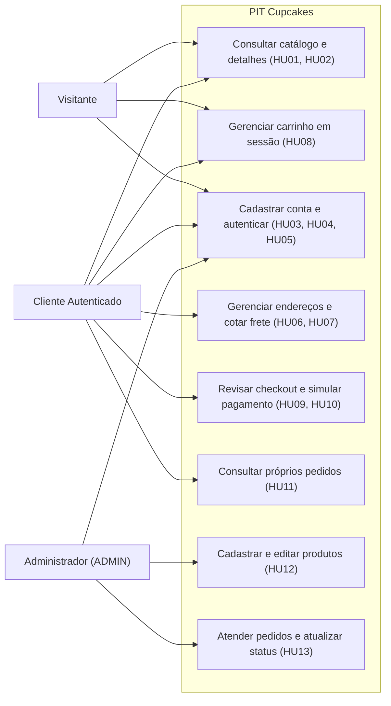
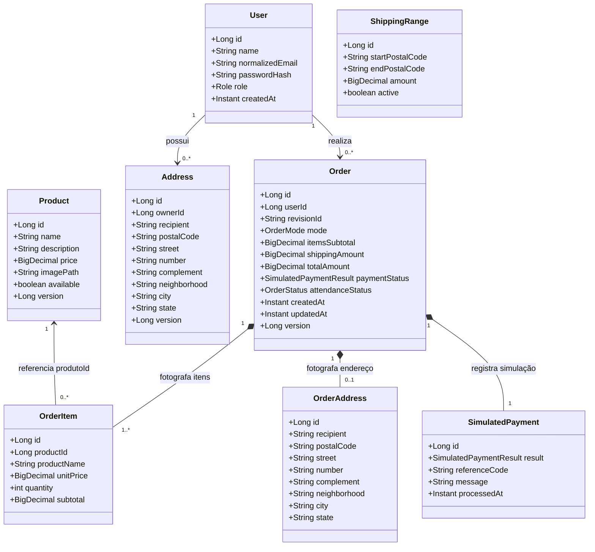
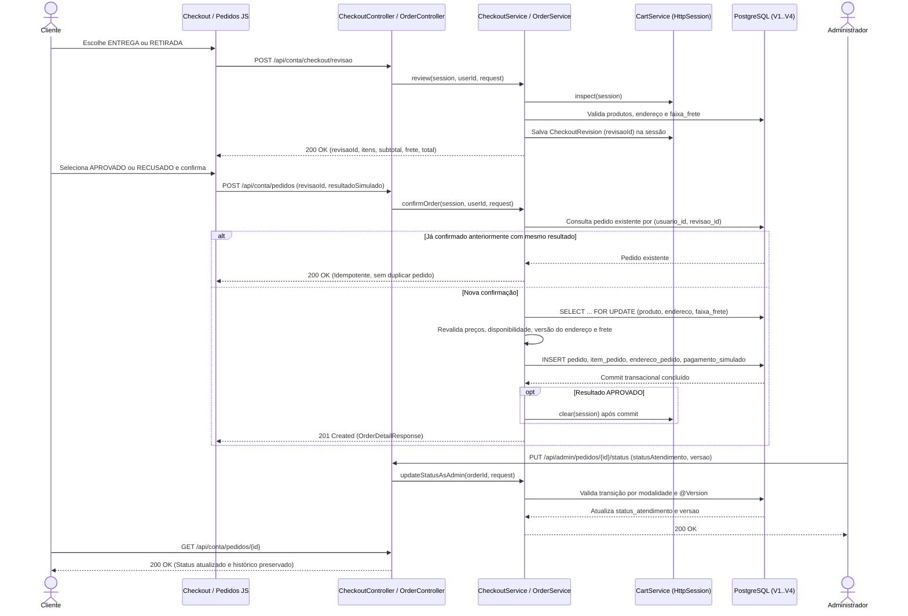
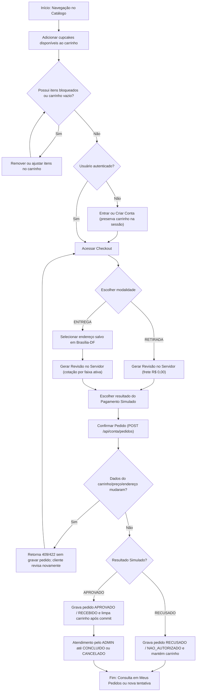

# Diagramas UML — PIT Cupcakes

Modelagem consolidada e enxuta do sistema conforme o código-fonte implementado nas migrações V1–V4 e módulos Spring Boot.

## 1. Diagrama de Casos de Uso

## 2. Diagrama de Classes de Domínio e Persistência

## 3. Diagrama de Sequência — Checkout, Confirmação Transacional e Atendimento

## 4. Diagrama de Atividade — Fluxo Completo de Compra e Pagamento Simulado

